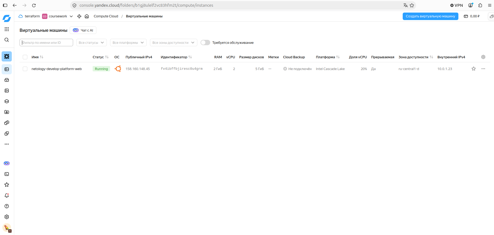
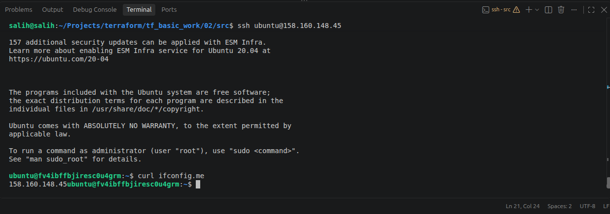
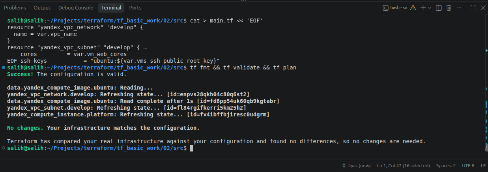
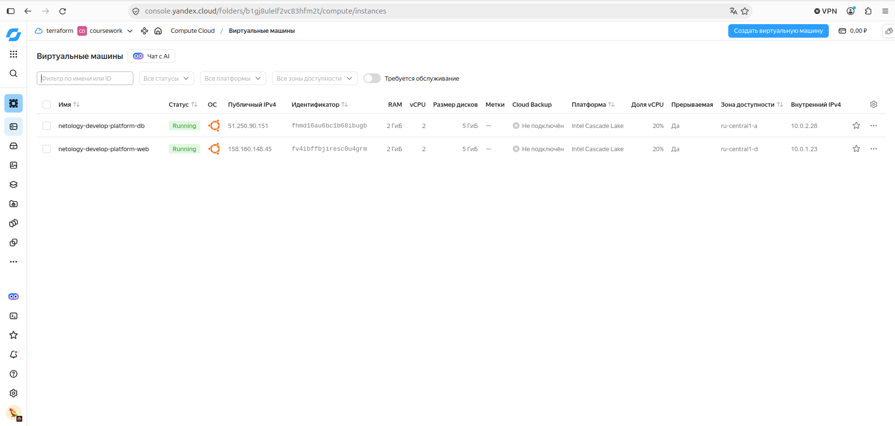

# Домашнее задание «Основы Terraform. Yandex Cloud»

## Задание 1

### Шаги

```bash
# 1. Сервисный аккаунт с ролью editor на каталог и авторизованный ключ
yc iam service-account create --name tf-sa
yc resource-manager folder add-access-binding <folder_id> \
  --role editor --subject serviceAccount:$(yc iam service-account get tf-sa --format json | jq -r .id)
yc iam key create --service-account-name tf-sa --output ~/.authorized_key.json

# 2. SSH-ключ
ssh-keygen -t ed25519            # если ключа ещё нет
cat ~/.ssh/id_ed25519.pub        # → vms_ssh_public_root_key в personal.auto.tfvars

# 3. Зеркало провайдеров (registry.terraform.io недоступен из РФ)
cp .terraformrc ~/.terraformrc

# 4. Запуск
cd src
cp personal.auto.tfvars.example personal.auto.tfvars   # заполнить cloud_id, folder_id, ключ
terraform init
terraform validate
terraform apply

# 5. Проверка
eval $(ssh-agent) && ssh-add
ssh ubuntu@$(terraform output -raw vm_external_ip) 'curl -s ifconfig.me'
```

### Скриншоты




### Найденные ошибки и их суть

1. **`platform_id = "standart-v4"`** — две ошибки сразу: опечатка `standart` → `standard`, и платформы `standard-v4` в Yandex Cloud нет (есть `standard-v1`, `standard-v2`, `standard-v3`). API отвечает, что платформа не найдена.
2. **`cores = 1`** — на стандартных платформах минимум **2 vCPU**, с одним ядром ВМ не создаётся.
3. **`core_fraction = 5` и выбор платформы** — гарантированная доля 5% поддерживается только на `standard-v1` и `standard-v2`; на `standard-v3` минимум 20%. Поэтому выбрана `standard-v1` (+ `cores = 2`, `memory = 1` — укладывается в допустимое соотношение памяти на ядро).
4. **Имя переменной ssh-ключа** — в задании ключ записывается в `vms_ssh_public_root_key`, а в коде использовалась `vms_ssh_root_key` с заглушкой `<your_ssh_ed25519_key>` в default. Переменная переименована, default убран, значение задаётся в `personal.auto.tfvars` (не попадает в git).

### Зачем `preemptible = true` и `core_fraction = 5` при обучении

- **`preemptible = true`** — прерываемая ВМ: Yandex Cloud может остановить её в любой момент и гарантированно останавливает через 24 часа, но стоит она в несколько раз дешевле. Для учебных стендов это идеально: ВМ живут недолго, и если забыть сделать `terraform destroy`, она сама выключится и не съест грант.
- **`core_fraction = 5`** — ВМ гарантированно получает только 5% времени vCPU (может кратковременно использовать больше). Такие ВМ заметно дешевле, а для учебных задач — поднять, подключиться по ssh, выполнить пару команд — производительности хватает.

Вместе они позволяют делать много подходов «создал — проверил — удалил», почти не тратя бюджет.

## Задание 2



## Задание 3



## Задание 4

В [`src/outputs.tf`](src/outputs.tf) объявлен один output `vms` — map, где для каждой ВМ (`web`, `db`) выводятся `instance_name`, `external_ip` и `fqdn`. Значения берутся из атрибутов ресурсов, без хардкода.

