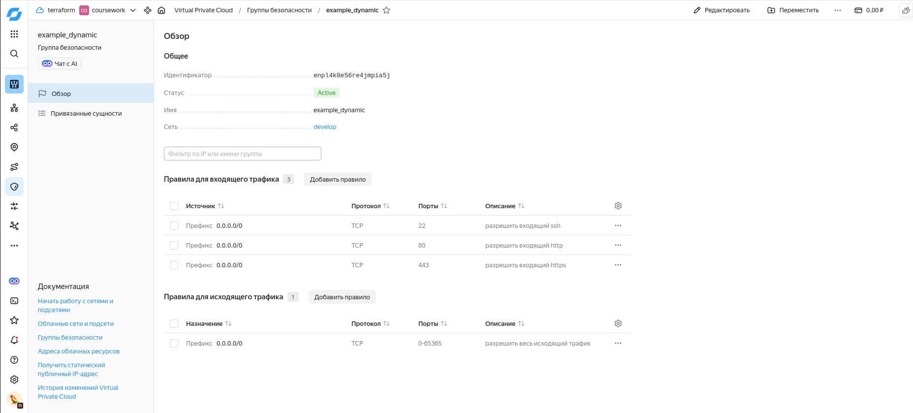
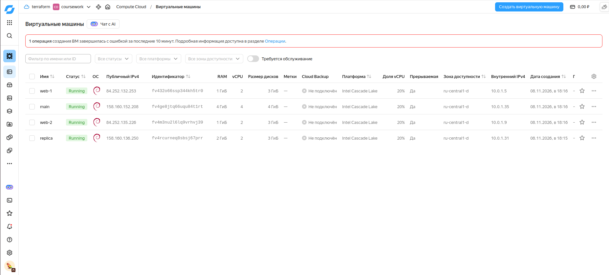
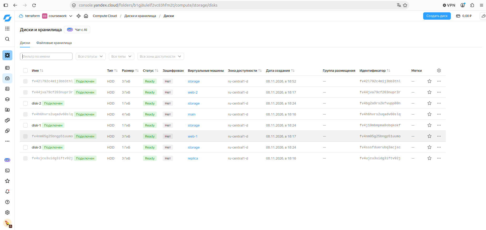
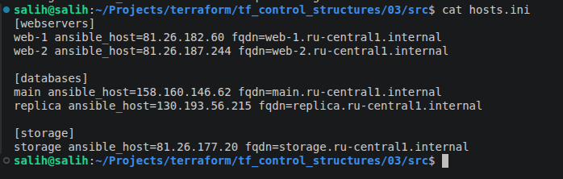

# Управляющие конструкции в terraform

## Задание 1

Проект инициализирован и применён: созданы сеть `develop`, подсеть `develop` и группа безопасности `example_dynamic` с динамическими правилами из переменных `security_group_ingress` / `security_group_egress`.

Изменения относительно исходного кода:
- авторизация через ключ сервисного аккаунта (`service_account_key_file`) вместо OAuth-токена, переменная `token` удалена;
- зона по умолчанию `ru-central1-d` — в `ru-central1-a` создание ВМ в моём облаке ограничено (`Resource allocation is restricted`), а `ru-central1-b` недоступна.

Входящие правила группы безопасности:

## Задание 2

- [`count-vm.tf`](src/count-vm.tf) — две одинаковые ВМ `web-1`, `web-2` через `count` (имя `"${var.web_name_prefix}-${count.index + 1}"`, чтобы нумерация начиналась с 1). ВМ назначена группа безопасности из задания 1: `security_group_ids = [yandex_vpc_security_group.example.id]`.
- [`for_each-vm.tf`](src/for_each-vm.tf) — ВМ `main` и `replica` с разными cpu/ram/disk через `for_each` по переменной `each_vm` (`list(object)`). Так как `for_each` принимает только map/set, список преобразуется: `{ for vm in var.each_vm : vm.vm_name => vm }`.
- Порядок создания: у web-ВМ `depends_on = [yandex_compute_instance.db]` — они создаются после ВМ БД (видно в логе `apply`).
- Ключ читается функцией `file()` в local-переменной ([`locals.tf`](src/locals.tf)) и используется в `metadata` из ДЗ-2. Используется ed25519-ключ (`~/.ssh/id_ed25519.pub`) вместо `id_rsa.pub`, путь вынесен в переменную `ssh_public_key_path`.
- Образ `debian-11` вместо Ubuntu: квота HDD в зоне `ru-central1-d` — 20 ГБ, минимальный диск Ubuntu 20.04 — 5 ГБ, у Debian 11 — 3 ГБ. Так все ВМ и 3 доп. диска из задания 3 укладываются в квоту.

## Задание 3

- В [`disk_vm.tf`](src/disk_vm.tf) создаются 3 диска по 1 ГБ: `yandex_compute_disk` с `count = var.storage_disk_count` (имена `disk-1..3`).
- Одиночная ВМ `storage` (без count/for_each) подключает их через `dynamic "secondary_disk"` с `for_each = yandex_compute_disk.storage`; количество подключаемых дисков определяется количеством созданных.
- Квота `compute.instanceCores.count` в `ru-central1-d — 2`, и считается она как `cores × core_fraction` (4 ВМ × 2 ядра × 20% = 2,0). Чтобы поместить 5-ю ВМ, у всех `ВМ core_fraction` снижен до 5% (поддерживается на standard-v2), для изменения работающих ВМ добавлен `allow_stopping_for_update = true`.

## Задание 4

- [`ansible.tf`](src/ansible.tf): `local_file` + `templatefile()` по шаблону [`hosts.tftpl`](src/hosts.tftpl).
- В шаблон передаются три группы: `web` (count → list), `values(db)` (for_each → map → list), `[storage]` (одиночный ресурс → список). Каждая группа — цикл `%{ for ~}`, поэтому inventory динамический (от 1 до N ВМ в группе).
- Для каждой ВМ: `ansible_host` (внешний IP) и `fqdn` (атрибут `fqdn`; так как задан `hostname`, имя вида `web-1.ru-central1.internal`).

