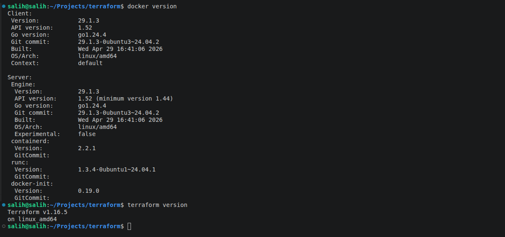

# Введение в terraform

## Чек лист готовности



* Изучите файл .gitignore. В каком terraform-файле, согласно этому .gitignore, допустимо сохранить личную, секретную информацию?(логины,пароли,ключи,токены итд)

`
Согласно [.gitgnore](/tf_init/01/src/.gitignore), допустимым файлом для хранения нежных данных является personal.auto.tfvars
`

* Выполните код проекта. Найдите в state-файле секретное содержимое созданного ресурса random_password, пришлите в качестве ответа конкретный ключ и его значение.

`
"result": "fO0uUEgw2HFCZnvh",
`

* Раскомментируйте блок кода, примерно расположенный на строчках 29–42 файла main.tf. Выполните команду terraform validate. Объясните, в чём заключаются намеренно допущенные ошибки. Исправьте их

```
╷
│ Error: Missing name for resource
│ 
│   on main.tf line 23, in resource "docker_image":
│   23: resource "docker_image" {
│ 
│ All resource blocks must have 2 labels (type, name).
╵
╷
│ Error: Invalid resource name
│ 
│   on main.tf line 28, in resource "docker_container" "1nginx":
│   28: resource "docker_container" "1nginx" {
│ 
│ A name must start with a letter or underscore and may contain only letters, digits, underscores, and dashes.
╵
╷
│ Error: Reference to undeclared resource
│ 
│   on main.tf line 30, in resource "docker_container" "nginx":
│   30:   name  = "example_${random_password.random_string_FAKE.resulT}"
│ 
│ A managed resource "random_password" "random_string_FAKE" has not been declared in the root module.
╵
```

```
Собствено, после раскоментирования и terraform validate, terraform сам подсказывает в каких строках и в чем ошибки:

1. Строка 23 отсутствует имя ресурса

Согласно terraform registry, синтаксис hcl блока resource должен содержать тип ресурса, здесь это "docker_image" и имя ресурса, здесь оно как раз отсутствовало

2. Строка 28 недопустимое имя ресурса

Имя ресурса указано как "1nginx"

3. Строка 30 ссылка на необъявленный ресурс

В имени указан необъявленный ресурс name  = "example_${random_password.random_string_FAKE.resulT}"

```

* Выполните код. В качестве ответа приложите: исправленный фрагмент кода и вывод команды docker ps.

```
resource "docker_image" "nginx" {
  name         = "nginx:latest"
  keep_locally = true
}

resource "docker_container" "nginx" {
  image = docker_image.nginx.image_id
  name  = "hello_world"

  ports {
    internal = 80
    external = 9090
  }
}
```


* Замените имя docker-контейнера в блоке кода на hello_world. Не перепутайте имя контейнера и имя образа. Мы всё ещё продолжаем использовать name = "nginx:latest". Выполните команду terraform apply -auto-approve. Объясните своими словами, в чём может быть опасность применения ключа -auto-approve. Догадайтесь или нагуглите зачем может пригодиться данный ключ? В качестве ответа дополнительно приложите вывод команды docker ps.

```
После выполнения команды видно 

Apply complete! Resources: 1 added, 0 changed, 1 destroyed.

Следовательно контейнер был не переименован, а уничтожен и создан заново. Следовательно в это и кроется опасность ключа -auto-approved, можно сненсти важную базу или ресурс.

Думаю данный ключ может все же пригодится при полной автоматизации, когда код был проверен заранее, когда человека нет за терминалом. Но мне пока сложно представить эту ситуацию. Рискну предположить что в преде на этапе тестирования этот код был уже отработан и после этого автоматически заливается в прод.
```

* Уничтожьте созданные ресурсы с помощью terraform. Убедитесь, что все ресурсы удалены. Приложите содержимое файла terraform.tfstate.

```
{
  "version": 4,
  "terraform_version": "1.16.5",
  "serial": 19,
  "lineage": "04dba00e-c3a2-9b09-f00f-c786e39332ce",
  "outputs": {},
  "resources": [],
  "check_results": null
}
```


* Объясните, почему при этом не был удалён docker-образ nginx:latest. Ответ ОБЯЗАТЕЛЬНО НАЙДИТЕ В ПРЕДОСТАВЛЕННОМ КОДЕ, а затем ОБЯЗАТЕЛЬНО ПОДКРЕПИТЕ строчкой из документации terraform провайдера docker. (ищите в классификаторе resource docker_image )

```
Строка 25 keep_locallt = true, образ должен хранится локально
```
keep_locally (Boolean) If true, then the Docker image won't be deleted on destroy operation. If this is false, it will delete the image from the docker local storage on destroy operation.


